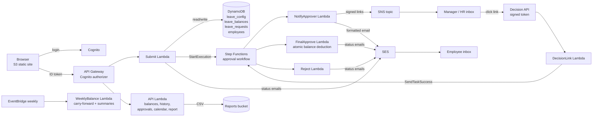

# Leave Management System (AWS serverless)

Employees apply for leave, managers approve or reject from an email link (or in the app),
leave longer than 5 working days also needs HR Admin approval, quotas are enforced
automatically, and managers/HR get a live absence calendar and CSV reports.

**Stack:** S3 static website · Cognito · API Gateway · Lambda (Python 3.12) · DynamoDB ·
Step Functions · SNS · SES · EventBridge Scheduler · Secrets Manager — all defined in one
AWS SAM template.

## Architecture



### Approval workflow (Step Functions)

```
NotifyManager ──(48h timeout)──► EscalateToHR ──(timeout)──► RejectTimeout
     │ decision                       │ decision
     ▼                                ▼
ManagerDecision ── REJECTED ──► RejectByManager        HRDecision ── REJECTED ──► RejectByHR
     │ APPROVED, days > 5 ──► NotifyHR ──(timeout)──► RejectTimeout    │
     │ APPROVED, days ≤ 5                │ decision ──────────────────►│ APPROVED
     ▼                                                                  ▼
FinalApprove ── balance too low ──► RejectBalanceChanged          FinalApprove
     ▼
  Approved
```

The full definition is in [`statemachine/leave_approval.asl.json`](statemachine/leave_approval.asl.json).

## Repository layout

| Path | What it is |
|---|---|
| `template.yaml` | All AWS resources: DynamoDB schema, Cognito, APIs, Lambdas, state machine, S3, SNS, schedule |
| `statemachine/leave_approval.asl.json` | Step Functions state machine definition (ASL) |
| `backend/src/handlers/` | One file per Lambda (`submit`, `api`, `decision_link`, `notify_approver`, `final_approve`, `reject`, `weekly_balance`) |
| `backend/src/common/` | Shared code: leave rules, DynamoDB helpers, signed tokens, emails |
| `backend/tests/` | 60 automated tests, including the whole workflow run against the real ASL file |
| `frontend/` | The website (plain HTML/CSS/JS, no build step) |
| `scripts/seed.py` | Loads leave types, holidays, employees, Cognito users, SNS subscriptions |
| `scripts/deploy_frontend.py` | Writes `frontend/config.js` and uploads the site to S3 |
| `docs/` | [Balance logic](docs/balance_logic.md), [edge case report](docs/edge_case_report.md), [DynamoDB schema](docs/dynamodb_schema.md) |

## Setup and deployment

### 1. Install tools (once)
- Python 3.12+, the [AWS CLI](https://docs.aws.amazon.com/cli/latest/userguide/getting-started-install.html) and the [AWS SAM CLI](https://docs.aws.amazon.com/serverless-application-model/latest/developerguide/install-sam-cli.html)
- `aws configure` with an IAM user's access key; region `ap-south-1` (Mumbai)
- `pip install -r requirements-dev.txt`

### 2. Verify the sender email in SES
New accounts are in the SES sandbox, which can only send **to and from verified addresses**.
```bash
aws ses verify-email-identity --email-address you@gmail.com --region ap-south-1
```
Click the link AWS emails you. Gmail tip: `you+emp@gmail.com`, `you+mgr@gmail.com` and
`you+hr@gmail.com` all arrive in the same inbox but count as three different users.

### 3. Deploy the backend
Edit `samconfig.toml` and replace `you@example.com` with your verified sender, then:
```bash
sam build
sam deploy            # 48-hour approval timeout
# or, for the demo:
sam deploy --config-env demo   # 2-minute timeout, so escalation can be shown live
```

### 4. Load data and create the test users
```bash
python scripts/seed.py --stack leave-mgmt --region ap-south-1 \
  --employee-email you+emp@gmail.com --manager-email you+mgr@gmail.com \
  --hr-email you+hr@gmail.com --password 'Leave@2026' --verify-ses
```
Then in your inbox: click the **3 SES verification links** and the **2 SNS "Confirm subscription"
links** (manager and HR). Until those are confirmed, SES/SNS will not deliver to them.

### 5. Upload the website
```bash
python scripts/deploy_frontend.py --stack leave-mgmt --region ap-south-1
```
Open the printed `WebsiteUrl` and sign in with any of the three emails and the password.

> If `sam deploy` fails on `FrontendBucketPolicy` with "public policies are blocked", your
> account has S3 Block Public Access turned on at the account level. Turn it off for this
> account (S3 console → Block Public Access settings for this account) or ask your admin.

## Demo script (deliverable 1)

1. Sign in as the **employee** → apply for 2 days of Casual leave → "Submitted" email arrives.
2. Manager inbox → open the approval email (SNS and SES copies) → **Approve** → confirm.
3. Step Functions console → *State machines* → `leave-mgmt-leave-approval` → latest execution →
   screenshot the green graph (`NotifyManager → ManagerDecision → FinalApprove → Approved`).
4. Employee inbox → "Leave approved" email showing the remaining balance.
5. Sign in again as the employee → balance reduced, history shows **Approved**.
6. Sign in as the **manager** → Team calendar shows the leave.
7. Long leave: apply for 6+ working days of Earned leave → manager approves → HR gets an email →
   execution graph shows the `NotifyHR` branch.
8. Timeout (deployed with `--config-env demo`): apply, don't click anything for 2 minutes →
   graph shows `EscalateToHR`; after another 2 minutes `RejectTimeout`.

Run the weekly job on demand from the Lambda console (`WeeklyBalanceFunction` → Test with `{}`),
or with `{"year": 2027}` to show the carry-forward into a new year.

## Changing the rules (no code changes)

Edit items in the `leave-mgmt-leave_config` table (DynamoDB console → Explore items):

| Item | Fields |
|---|---|
| `SICK`, `CASUAL`, `EARNED`, `UNPAID`, or any new type | `annual_quota`, `requires_balance`, `carry_forward`, `max_carry_forward`, `min_notice_days`, `max_backdate_days`, `max_consecutive_days`, `active`, `name` |
| `SYSTEM#SETTINGS` | `hr_approval_threshold_days` (default 5) |
| `SYSTEM#HOLIDAYS#2026` | `dates`: list of `YYYY-MM-DD` not counted as leave days |

A new leave type appears in the form immediately, and each employee's balance for it is created
from `annual_quota` the first time it is used.

## Running the tests
```bash
cd backend
python -m pytest -q
```
The tests need no AWS account. They use in-memory fakes that parse and check every DynamoDB
expression (reserved words, undefined/unused placeholders) and an interpreter that runs the real
`leave_approval.asl.json`, so the whole approve/reject/timeout flow is tested end to end.

## Security notes
- Every app API route requires a Cognito ID token; `employee_id` always comes from the verified
  token, never from the request body. Users can't change their own `custom:employee_id`.
- Email links carry an HMAC-SHA256 signed, expiring token; the key is generated into Secrets
  Manager. Opening a link only shows a confirmation page (`GET`); the decision is recorded by the
  confirm button (`POST`), so email scanners can't approve by pre-opening links.
- A decision is "claimed" with a conditional write, so double clicks, or the email link and the
  in-app button used together, can only resume the workflow once.
- Approvers can't approve their own leave. Task tokens are never sent to the browser.
- Each Lambda has its own IAM role limited to the tables and services it uses.

## Cost
For a demo this stays within the AWS Free Tier except Secrets Manager (about US$0.40/month for
one secret). Delete everything afterwards with `sam delete --stack-name leave-mgmt`
(empty the two S3 buckets first).

## Known limitations
- Leave is counted in whole working days (no half days).
- A request can't span two calendar years (submit one per year).
- An HR Admin's own long leave needs a second HR Admin; with only one, it is rejected with a clear
  "no approver" reason.
- Cancelling a submitted request is not implemented.
- SES sandbox: only verified addresses receive email until production access is requested.
